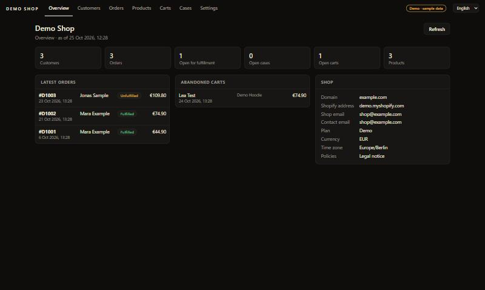
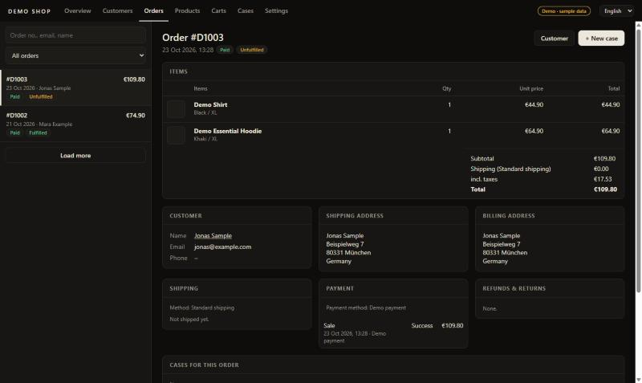

# Counterdesk

**Customer service desk for Shopify stores – a Windows program.** Test version 1.0.0-beta.2.

Find a customer, open the full customer file, read every order in detail, answer product questions,
follow up on abandoned carts and track customer cases with notes and reply templates – alone or as a team.
English and German.

**[⬇ Download the test version (Windows, 35 MB)](https://github.com/ODINSn1pex/counterdesk/releases)** · [Feedback & bug reports](https://github.com/ODINSn1pex/counterdesk/issues) · [Test terms & privacy](TEST-TERMS.md) · [Deutsch ↓](#deutsch)

Screenshots show fictional demo data.

## What it does

- **Customers** – search by name, email, phone or order number; addresses, account status, marketing consent, all orders, Shopify history. Edit name, email, phone, tags and internal note.
- **Orders** – items with images and SKUs, totals, discounts, taxes, shipping and billing address, shipments with tracking, payments, refunds, returns, history. Filters for open, unpaid, refunded and cancelled orders.
- **Products** – all variants with price, SKU and availability.
- **Abandoned carts** – who left what, with a link the customer can use to resume the purchase.
- **Cases** – category, channel, status, notes; reply templates with placeholders. In team mode, cases are stored in your Shopify store and shared with everyone using the same app.
- **Your browser** – choose which browser opens links to your store and the Shopify admin (any installed browser or a custom .exe).
- **Large stores** – page-by-page loading and automatic handling of Shopify's rate limits.

## Get started

1. Download `Counterdesk-1.0.0-beta.2-windows.zip` from [Releases](https://github.com/ODINSn1pex/counterdesk/releases), unzip, start `Counterdesk.exe`.
   Windows SmartScreen may warn because test versions are not signed yet: **More info → Run anyway**.
2. Follow the built-in setup (about 10 minutes): create an app in the [Shopify Dev Dashboard](https://dev.shopify.com/dashboard), set the scopes shown in the program, install the app on your store, paste the client ID and secret.
3. Just looking? Run `Counterdesk.exe --demo` for fictional sample data.

Requirements: Windows 10/11 with Microsoft Edge (for the program window). Links to your store and the Shopify admin open in the browser of your choice (Settings → Links).

## Privacy in short

Counterdesk has **no server**. It runs on your PC and talks only to your Shopify store, plus an update check at GitHub. No network port is opened. Credentials and settings stay on your PC. Details: [TEST-TERMS.md](TEST-TERMS.md).

**Please never post customer data, screenshots with customer data or credentials in issues – they are public.**

## Verify the download

SHA-256 checksums are attached to each release (`SHA256SUMS.txt`).

---

## Deutsch

**Kundenservice-Programm für Shopify-Shops unter Windows.** Testversion 1.0.0-beta.2, auf Englisch und Deutsch (umschaltbar oben rechts).

Kunden finden, die ganze Kundenakte öffnen, Bestellungen im Detail lesen, Produktfragen beantworten, abgebrochene Warenkörbe nachverfolgen und Kundenanliegen mit Notizen und Textbausteinen bearbeiten – allein oder im Team.

**[⬇ Testversion herunterladen (Windows, 35 MB)](https://github.com/ODINSn1pex/counterdesk/releases)** · [Rückmeldungen & Fehler](https://github.com/ODINSn1pex/counterdesk/issues) · [Testbedingungen & Datenschutz](TESTBEDINGUNGEN.md)

1. ZIP aus den [Releases](https://github.com/ODINSn1pex/counterdesk/releases) laden, entpacken, `Counterdesk.exe` starten. SmartScreen-Warnung (Testversionen sind noch nicht signiert): **Weitere Informationen → Trotzdem ausführen**.
2. Der eingebauten Einrichtung folgen (ca. 10 Minuten): App im Shopify Dev Dashboard anlegen, die angezeigten Berechtigungen eintragen, im Shop installieren, Client-ID und Secret einfügen.
3. Nur anschauen? `Counterdesk.exe --demo` startet mit erfundenen Beispieldaten.

Counterdesk hat **keinen Server**: Daten gehen nur zwischen deinem PC und deinem Shopify-Shop (plus Update-Prüfung bei GitHub). **Bitte in Issues niemals Kundendaten oder Zugangsdaten posten – sie sind öffentlich.**

---

Counterdesk is an independent program and is not affiliated with or endorsed by Shopify. Shopify is a trademark of Shopify Inc.
